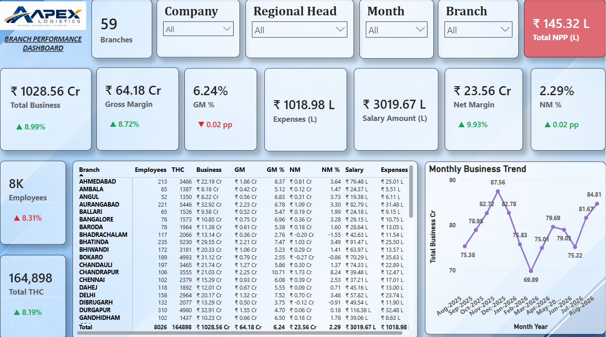
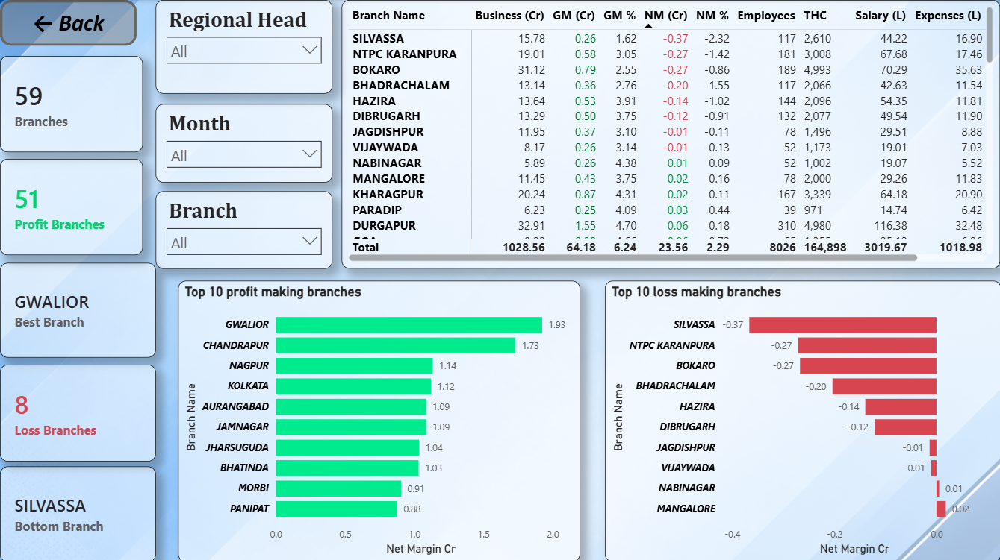
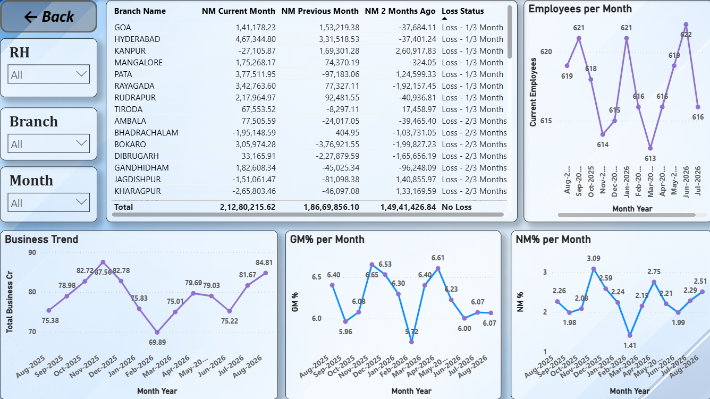

# Branch Profitability Dashboard | Power BI

## Project Overview
An interactive Power BI dashboard designed to analyze branch-level business volume, profitability, and operational performance. It provides management with visibility into key financial KPIs and performance trends.

## Tools & Technologies
- Power BI
- DAX
- Power Query
- Microsoft Excel

## Dashboard Screenshots

### Page 1

### Page 2

### Page 3

## Key Features
- Branch-level business and profitability analysis
- Gross margin and net margin monitoring
- Monthly performance analysis
- Interactive KPI reporting

## Key Learnings
Developed practical skills in data transformation, DAX calculations, financial KPI analysis, and interactive dashboard design.
